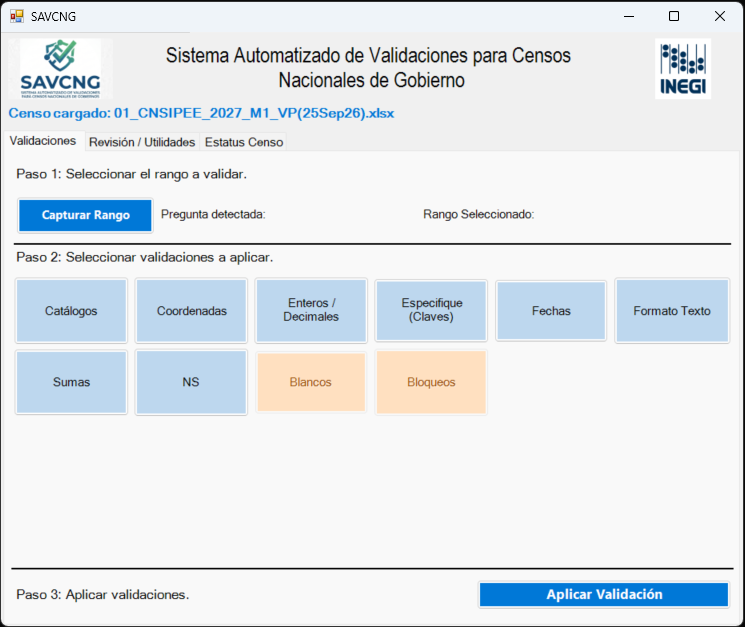
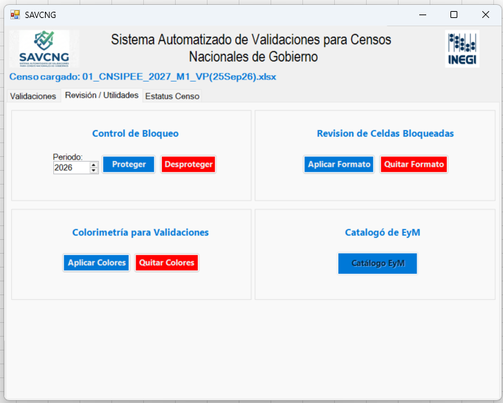
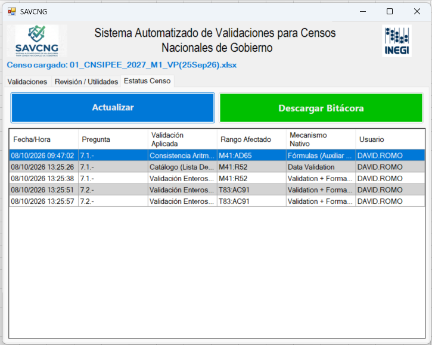

# Conoce las pestañas de SAVCNG

La ventana de SAVCNG organiza el trabajo en tres pestañas: **Validaciones**, **Revisión / Utilidades** y **Estatus Censo**. Esta página presenta su propósito; consulta las guías enlazadas para conocer el uso detallado de cada validación.

<strong>Imagen 1.</strong> Pestaña Validaciones: aquí se encuentran las reglas disponibles para revisar la información del censo.

## Validaciones

Es la pestaña principal de la aplicación y contiene las validaciones que se pueden aplicar a la información del censo. Abre el [índice de validaciones](validaciones/index.md) para elegir una regla y consultar sus instrucciones paso a paso.

## Revisión / Utilidades

Esta pestaña reúne herramientas para trabajar con el libro sin seleccionar una validación de captura:

- **Control de Bloqueo:** permite proteger o desproteger celdas. El control **Periodo** indica el periodo que se usará al proteger.
- **Revisión de Celdas Bloqueadas:** aplica o quita el formato visual usado para distinguir celdas bloqueadas.
- **Colorimetría para Validaciones:** aplica o quita colores relacionados con el estado de las validaciones.

El botón de **Catálogo de EyM** aparece en la captura, pero todavía no está habilitado; por ello no se describe su uso en esta guía.

<strong>Imagen 2.</strong> Pestaña Revisión / Utilidades: control de bloqueo, formato para celdas bloqueadas y colorimetría.

## Estatus Censo

Esta pestaña funciona como una bitácora de las validaciones que se van registrando para el censo. En la tabla puedes consultar:

| Columna | Información |
| --- | --- |
| **Fecha/Hora** | Momento en que se registró la acción. |
| **Pregunta** | Pregunta relacionada con el rango revisado, cuando está disponible. |
| **Validación Aplicada** | Regla o acción registrada. |
| **Rango Afectado** | Celdas del libro relacionadas con la acción. |
| **Mecanismo Nativo** | Mecanismo de Excel utilizado, si corresponde. |
| **Usuario** | Usuario asociado al registro. |

Usa **Actualizar** para volver a cargar la bitácora visible y **Descargar Bitácora** para obtener un archivo con sus registros y consultarlos fuera de SAVCNG.

<strong>Imagen 3.</strong> Pestaña Estatus Censo: bitácora con la fecha, pregunta, validación, rango afectado, mecanismo y usuario.

